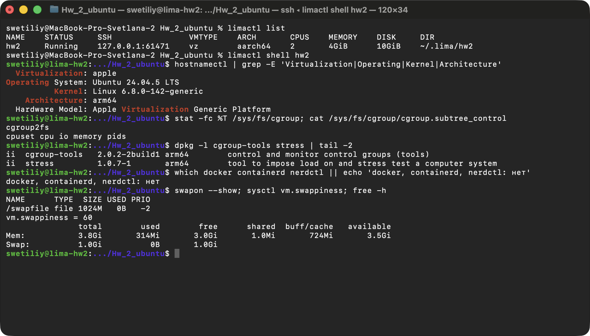
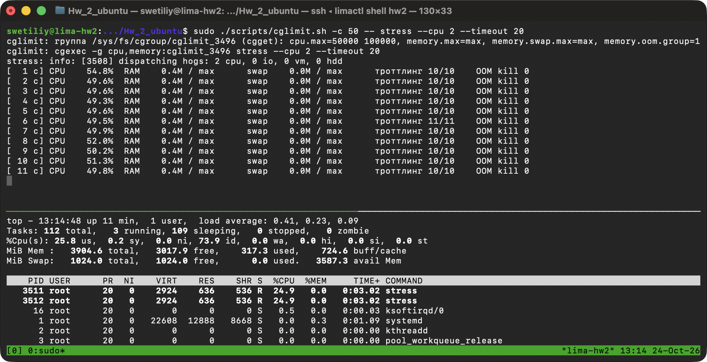
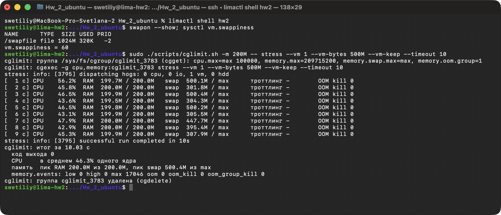
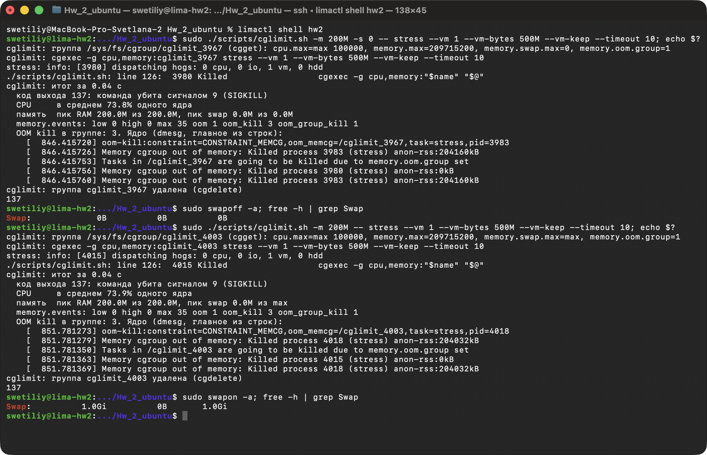
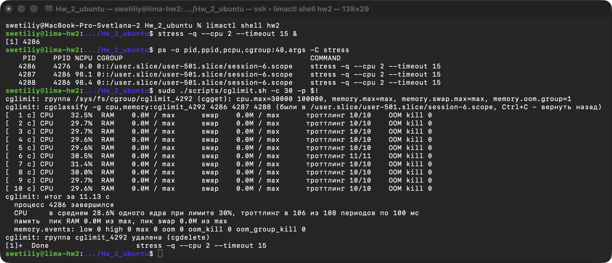

# ДЗ 2.1. cgroups: ограничение CPU и памяти процесса в Ubuntu

Стенд: MacBook Pro, Apple M1 Pro, 16 ГБ, macOS 26.6. На нем виртуальная машина Lima `hw2` (Apple Virtualization.framework):
Ubuntu 24.04.5 LTS, ядро 6.8.0-142-generic (arm64), 2 vCPU, 4 ГБ RAM, диск 10 ГБ, swap-файл 1 ГБ.
cgroup v2, `cgroup-tools` 2.0.2, `stress` 1.0.7. Контейнеров нет: containerd и nerdctl в Lima выключены, Docker не ставился.
Скриншоты сняты с окна Terminal на маке, команды выполняются в VM через `limactl shell hw2`. Версия ДЗ без VM, только для macOS, лежит в `Hw_2/`.



## Файлы

| Файл | Назначение |
|---|---|
| `scripts/cglimit.sh` | утилита: ограничивает CPU и память новой команды или уже запущенного процесса через cgroup-tools, печатает статистику группы и итог с OOM kill |
| `lima/hw2.yaml` | конфиг VM: Ubuntu 24.04, 2 CPU, 4 ГБ, 10 ГБ, без containerd; при первом старте ставит `cgroup-tools` и `stress` |
| `screenshots/` | рисунки 1-5 |

## Запуск

В Ubuntu (22.04 и новее, там cgroup v2 по умолчанию):

```bash
sudo apt install -y cgroup-tools stress
sudo ./scripts/cglimit.sh -c 50 -- stress --cpu 2 --timeout 20                                  # 50% одного ядра на всю группу
sudo ./scripts/cglimit.sh -m 200M -- stress --vm 1 --vm-bytes 500M --vm-keep --timeout 10       # RAM 200 МБ, остальное в swap
sudo ./scripts/cglimit.sh -m 200M -s 0 -- stress --vm 1 --vm-bytes 500M --vm-keep --timeout 10  # swap запрещен: OOM kill, код 137
sudo ./scripts/cglimit.sh -c 30 -m 200M -s 0 -p PID                                             # уже запущенный процесс
```

| Опция | Что задает | Файл группы |
|---|---|---|
| `-c CPU%` | доля CPU в процентах одного ядра на всю группу: 50 - пол-ядра, 150 - полтора | `cpu.max` |
| `-m MEM` | лимит RAM: `200M`, `1G` | `memory.max` |
| `-s SWAP` | лимит swap: `0` - запрещен, `max` - без лимита; без `-s` не меняется (по умолчанию `max`) | `memory.swap.max` |
| `-p PID` | ограничить работающий процесс с потомками; Ctrl+C - вернуть их в прежнюю группу | `cgroup.procs` |
| `-n NAME`, `-i SEC` | имя группы (по умолчанию `cglimit_<PID>`) и период вывода статистики (1 с) | |

На маке - виртуальная машина Lima (из папки `Hw_2_ubuntu`, она монтируется в VM по тому же пути с правом записи):

```bash
brew install lima                                              # Lima 2.2.1
limactl create --name=hw2 --mount-only="$PWD:w" lima/hw2.yaml  # скачает образ Ubuntu 24.04 (~600 МБ)
limactl start hw2
limactl shell hw2                                              # оболочка в VM сразу в этой же папке
# в Lima-образе swap нет - swap-файл 1 ГБ:
sudo fallocate -l 1G /swapfile && sudo chmod 600 /swapfile && sudo mkswap /swapfile && sudo swapon /swapfile
echo '/swapfile none swap sw 0 0' | sudo tee -a /etc/fstab    # включать при загрузке
limactl stop hw2                                               # выключить; limactl delete hw2 - удалить
```

## 1. cgroups v2 и cgroup-tools

**cgroup** (control group) - группа процессов, для которой ядро считает и ограничивает ресурсы. В v2 это каталог в `/sys/fs/cgroup`: процессы группы перечислены в `cgroup.procs`, лимиты и статистика - файлы рядом. Потомки процесса попадают в его группу автоматически и сами выйти из нее не могут. Пакет `cgroup-tools` (библиотека libcgroup) - обертка над этими файлами:

| Команда | Что делает в cgroup v2 |
|---|---|
| `cgcreate -g cpu,memory:NAME` | `mkdir /sys/fs/cgroup/NAME`, контроллеры `cpu` и `memory` включены в `cgroup.subtree_control` родителя |
| `cgset -r memory.max=200M NAME` | пишет значение в файл `/sys/fs/cgroup/NAME/memory.max` |
| `cgget -r memory.max NAME` | читает файл |
| `cgexec -g cpu,memory:NAME cmd` | записывает свой PID в `cgroup.procs` группы и делает `exec cmd`: команда и все ее потомки в группе |
| `cgclassify -g cpu,memory:NAME PID` | переносит процесс: пишет PID в `cgroup.procs` |
| `cgdelete -g cpu,memory:NAME` | `rmdir`; оставшиеся процессы libcgroup сначала переносит в родительскую группу |

В cgroup v1 (Ubuntu 20.04 и старше) у каждого контроллера своя иерархия и другие имена: `cpu.cfs_quota_us` / `cpu.cfs_period_us`, `memory.limit_in_bytes`, `memory.memsw.limit_in_bytes` (RAM + swap, нужен `swapaccount=1`). Скрипт работает только с v2 и на v1 пишет об этом.

## 2. Как устроен cglimit.sh

1. **Проверки:** root, есть ли команды `cgcreate`, `cgset`, `cgget`, `cgexec`, `cgclassify`, `cgdelete` (нет - подсказка `sudo apt install cgroup-tools`), смонтирован ли cgroup v2.
2. **Группа:** `cgcreate`, потом `cgset` для каждого лимита, `cgget` печатает, что получилось.
3. **Запуск:** команда - через `cgexec`, работающий процесс и его потомки (по `pgrep -P`) - через `cgclassify`.
4. **Статистика** раз в секунду из файлов группы, пока в ней есть процессы (`populated 1` в `cgroup.events`).
5. **Итог** и **уборка** (`trap ... EXIT`, срабатывает и на Ctrl+C): оставшиеся процессы команды убиваются через `cgroup.kill`, процессы из `-p` возвращаются в прежнюю группу через `cgclassify`, группа удаляется `cgdelete`. Скрипт выходит с кодом команды.

| Параметр | Как работает в ядре |
|---|---|
| `cpu.max = "50000 100000"` | квота 50 мс CPU на каждый период 100 мс на всю группу. Квота кончилась - потоки группы снимаются с CPU до конца периода (троттлинг) |
| `memory.max = 200M` | жесткий лимит RAM (анонимная память + page cache). Дошли до него - ядро вытесняет страницы группы (сбрасывает кэш, анонимные страницы - в swap). Вытеснить некуда - OOM killer внутри группы |
| `memory.swap.max = 0` | сколько группе можно занять в swap; 0 - нисколько |
| `memory.oom.group = 1` | ставится всегда: при OOM ядро убивает всю группу, а не только самый большой процесс. Без этого `stress` теряет только рабочий процесс и выходит с кодом 1 (проверено) |

| Что печатает | Откуда |
|---|---|
| `CPU 49.6%` | разница `usage_usec` из `cpu.stat` за секунду, в процентах одного ядра |
| `троттлинг 10/10` | разница `nr_throttled` / `nr_periods` из `cpu.stat`: в скольких периодах по 100 мс группа уперлась в квоту |
| `RAM`, `swap` | `memory.current` / `memory.max`, `memory.swap.current` / `memory.swap.max`; пики в итоге - `memory.peak`, `memory.swap.peak` |
| `memory.events` | `max` - сколько раз группа упиралась в `memory.max`, `oom` - сколько раз не смогли освободить память, `oom_kill` - сколько процессов убито |
| строки ядра | `dmesg` с начала запуска: `oom-kill:...`, `Killed process ...` (длинные строки сокращены) |

## 3. Демонстрация

### 3.1 CPU

```bash
sudo ./scripts/cglimit.sh -c 50 -- stress --cpu 2 --timeout 20    # сверху
top                                                               # снизу, в tmux
```



Без лимита два процесса `stress --cpu 2` заняли бы оба vCPU, 200%. С `cpu.max=50000 100000` группа получает 49-51% каждую секунду, троттлинг 10/10: квоту исчерпывают в каждом периоде. В `top` у каждого `stress` около 25%, а строка `%Cpu(s): 25.8 us` - это доля от обоих vCPU, то есть те же 50% одного ядра. Итог:

```
cglimit: итог за 20.05 с
  код выхода 0
  CPU     в среднем 50.1% одного ядра при лимите 50%, троттлинг в 201 из 201 периодов по 100 мс
```

С `-c 150` те же два процесса получают 149.5%: лимит может быть и больше одного ядра.

### 3.2 Память со swap: процесс не убит

```bash
swapon --show; sysctl vm.swappiness
sudo ./scripts/cglimit.sh -m 200M -- stress --vm 1 --vm-bytes 500M --vm-keep --timeout 10
```



`stress` занимает 500 МБ и все время их перезаписывает. RAM группы стоит на 199.5-200.0 МБ из 200, остальное ядро вытесняет в swap: `swap` 300-500 МБ. Процесс не убит: код 0, `oom 0`, зато `max 17046` - столько раз группа упиралась в лимит и ядро вытесняло ее страницы. Цена - скорость: CPU 46% вместо 100%, процесс ждет swap. `swap` скачет от 300 до 500 МБ, потому что страница, вернувшаяся из swap и перезаписанная, теряет копию в swap: 300 МБ - то, что не влезло в RAM, остальное - копии еще не перезаписанных страниц.

Настройки swap:

| Что | Где |
|---|---|
| есть ли swap | `swapon --show`, `free -h`. В образе Lima swap нет, мы создали `/swapfile` на 1 ГБ |
| swap группы | `memory.swap.max` (`-s`), есть еще мягкий `memory.swap.high` |
| охотно ли ядро свопит | `vm.swappiness` (0-200, по умолчанию 60): чем больше, тем охотнее вытесняет анонимную память, а не page cache. В v2 оно только общее, своего `memory.swappiness` у группы нет |
| выключить swap совсем | `sudo swapoff -a`, включить - `sudo swapon -a` |

### 3.3 OOM kill

```bash
sudo ./scripts/cglimit.sh -m 200M -s 0 -- stress --vm 1 --vm-bytes 500M --vm-keep --timeout 10; echo $?
sudo swapoff -a; free -h | grep Swap
sudo ./scripts/cglimit.sh -m 200M -- stress --vm 1 --vm-bytes 500M --vm-keep --timeout 10; echo $?
sudo swapon -a
```



Оба способа дают одно: вытеснять анонимную память некуда, и за 0.04 с после старта RAM группы упирается в 200 МБ. Ядро запускает OOM killer только внутри группы (`constraint=CONSTRAINT_MEMCG`, остальная система не страдает), убивает рабочий процесс `stress` (anon-rss 204 МБ), а из-за `memory.oom.group` - и родителя. Команда завершается с кодом **137 = 128 + 9 (SIGKILL)**, строку `Killed` печатает bash. `oom_kill 3`: рабочий процесс посчитан дважды (жертва OOM killer и потом вся группа) плюс родитель. Полные строки ядра (`sudo dmesg`):

```
[  851.781273] oom-kill:constraint=CONSTRAINT_MEMCG,nodemask=(null),cpuset=cglimit_4003,mems_allowed=0,oom_memcg=/cglimit_4003,task_memcg=/cglimit_4003,task=stress,pid=4018,uid=0
[  851.781279] Memory cgroup out of memory: Killed process 4018 (stress) total-vm:514928kB, anon-rss:204032kB, file-rss:512kB, shmem-rss:0kB, UID:0 pgtables:460kB oom_score_adj:0
```

### 3.4 Уже запущенный процесс

```bash
stress -q --cpu 2 --timeout 15 &
ps -o pid,ppid,pcpu,cgroup:48,args -C stress
sudo ./scripts/cglimit.sh -c 30 -p $!
```



До переноса у рабочих процессов по 98-99% CPU и группа `session-6.scope`. `cgclassify` переносит родителя и двух потомков в новую группу, и с этого момента у них на троих 29.5-30%. Ctrl+C снимает ограничение: процессы возвращаются в `session-6.scope` и снова занимают оба ядра (проверено, в `ps` по 54% от момента старта и растет).

С памятью есть тонкость: в v2 память, выделенная до переноса, остается на счету старой группы, поэтому `RAM 0.0M`. Новые выделения уже считаются в новой группе. `stress --vm 1 --vm-bytes 300M` (без `--vm-keep` он освобождает и снова выделяет память) под `-m 200M -s 0 -p PID` убит через 0.89 с:

```
  memory.events: low 0 high 0 max 35 oom 1 oom_kill 3 oom_group_kill 1
    [ 1044.997389] Memory cgroup out of memory: Killed process 4411 (stress) anon-rss:280420kB
bash: line 1:  4409 Killed                  stress -q --vm 1 --vm-bytes 300M --timeout 60
stress: код 137
```

anon-rss 274 МБ больше лимита: часть этих страниц выделена до переноса и числится за старой группой.

## Выводы

- cgroups ограничивает ресурсы группы процессов на уровне ядра, `cgroup-tools` только пишет и читает файлы в `/sys/fs/cgroup`: `cgcreate`, `cgset`, `cgexec`/`cgclassify`, `cgget`, `cgdelete`.
- `cpu.max` держит CPU точно: 50.1% при лимите 50%, 29.5-30% при лимите 30%, ядро троттлит группу каждые 100 мс.
- `memory.max` ограничивает только RAM. Пока есть swap и `memory.swap.max` не задан, процесс не убивают, а вытесняют в swap (рис. 3). OOM kill наступает, когда swap группе запрещен (`memory.swap.max=0`) или выключен (`swapoff -a`): код 137, в `memory.events` `oom_kill`, в `dmesg` `Memory cgroup out of memory: Killed process`.
- OOM killer группы не трогает остальную систему, а `memory.oom.group=1` убивает всю команду целиком, как контейнер.

Источники: документация ядра Linux `Documentation/admin-guide/cgroup-v2.rst` (`cpu.max`, `cpu.stat`, `memory.max`, `memory.swap.max`, `memory.oom.group`, `memory.events`, `cgroup.kill`) и `Documentation/admin-guide/sysctl/vm.rst` (`swappiness`); `man cgcreate`, `man cgset`, `man cgget`, `man cgexec`, `man cgclassify`, `man cgdelete`, `man stress`, `man swapon`, `man mkswap`; документация Lima: lima-vm.io.
