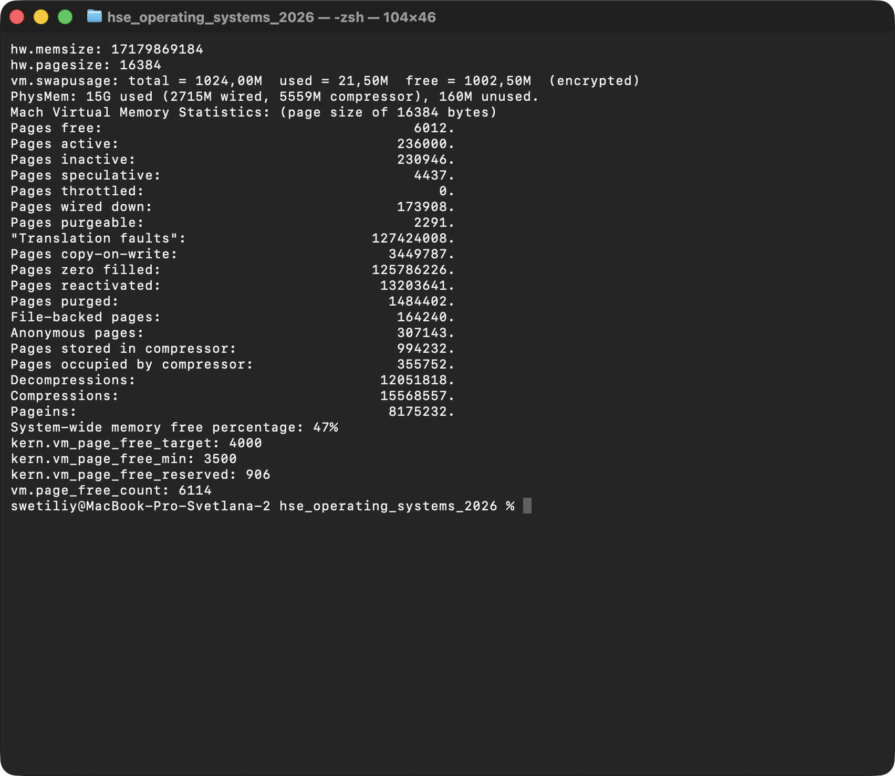
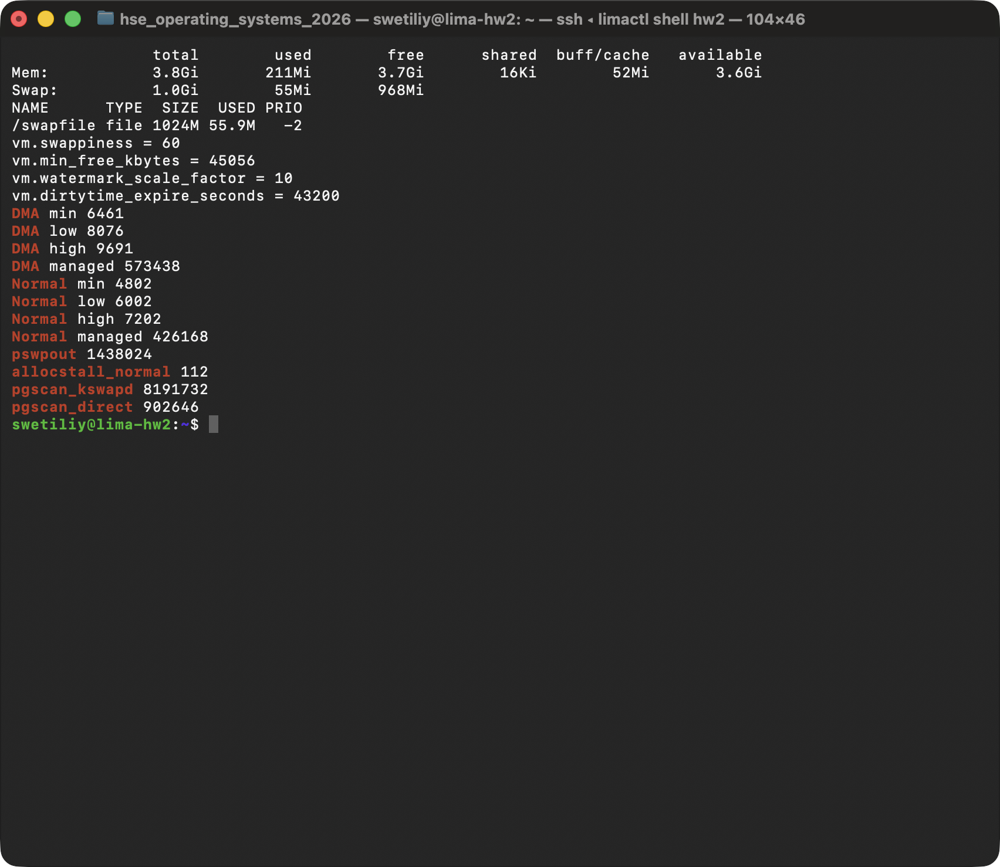
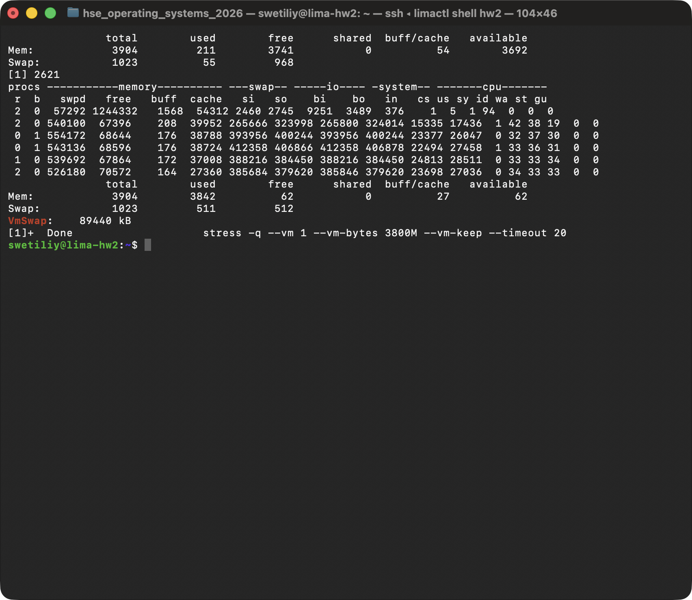

# ДЗ 3.1. Управление памятью

Стенд: MacBook Pro, Apple M1 Pro, 16 ГБ, macOS 26.6.2 (ядро XNU). Там, где в macOS нет аналога, - виртуальная машина Lima `hw2`: Ubuntu 24.04.5, ядро 6.8.0-142-generic (arm64), 2 vCPU, 4 ГБ RAM, swap-файл 1 ГБ (та же VM, что в `Hw_2_ubuntu`).
Скриншоты сняты с окна Terminal на маке, команды в VM выполняются через `limactl shell hw2`. Все цифры - из реальных запусков 24.10.2026.

## Файлы

| Файл | Назначение |
|---|---|
| `README.md` | отчет |
| `screenshots/01_mac_mem.png` | память мака: `top`, `vm_stat`, swap, пороги pageout daemon |
| `screenshots/02_linux_mem.png` | память VM: `free`, swap, sysctl, watermarks из `/proc/zoneinfo` |
| `screenshots/03_swap.png` | заполнение памяти в VM и уход страниц в swap |

Термины лекции: виртуальная память, страничная адресация (страница - единица отображения), свопинг - подкачка с диска и выгрузка на диск. Ниже они на живой системе.

## 1. Память в системе: сколько свободно, сколько занято, чем занято

### macOS

```bash
sysctl hw.memsize hw.pagesize vm.swapusage
top -l 1 -s 0 | grep PhysMem
vm_stat | head -20
memory_pressure | tail -1
```



Страница на Apple Silicon - 16 КБ, а не 4096 байт, как на лекции («для некоторых архитектур больше»). Всего 16 ГБ = 1 048 576 страниц.

| `vm_stat` | Страниц | ГБ | Что это | Аналог в Linux |
|---|---|---|---|---|
| Pages free | 6 012 | 0.09 | свободно | MemFree |
| Pages active | 236 000 | 3.6 | используются сейчас | Active |
| Pages inactive | 230 946 | 3.5 | давно не трогали, кандидаты на освобождение | Inactive |
| Pages speculative | 4 437 | 0.07 | прочитаны заранее (read-ahead) | часть Cached |
| Pages wired down | 173 908 | 2.7 | ядро и драйверы, вытеснить нельзя | Slab, KernelStack, Mlocked |
| Pages occupied by compressor | 355 752 | 5.4 | сжатые страницы в RAM | zswap (в Linux по умолчанию выключен) |
| File-backed pages | 164 240 | 2.5 | кэш файлов | Cached (file) |
| Anonymous pages | 307 143 | 4.7 | куча и стек программ | AnonPages |

- `PhysMem: 15G used (2715M wired, 5559M compressor), 160M unused` - занято почти все, свободно 0.1 ГБ. Это нормально: свободную память система отдает под кэш и сжатые данные.
- Компрессор хранит 994 232 страницы (15.2 ГБ данных) в 5.4 ГБ RAM - сжатие в 2.8 раза. Так macOS экономит swap.
- `System-wide memory free percentage: 47%` - сколько система считает доступным (аналог `MemAvailable`).
- Больше всего RAM у Claude, firefox, VS Code (`ps -axmc -o rss,comm | head`).
- Вывод: память мака занята, но не перегружена: 47% можно освободить, swap почти пустой.

### Linux (VM)

```bash
free -h
grep -E "^(MemTotal|MemFree|MemAvailable|Cached|AnonPages|Active|Inactive|Slab|Mlocked|Swap)" /proc/meminfo
```



| `free` | Значение | Что это |
|---|---|---|
| total | 3.8 ГБ | 4 ГБ минус память ядра и резервы |
| used | 211 МБ | программы (AnonPages) + ядро (Slab и пр.) |
| free | 3.7 ГБ | совсем свободно |
| buff/cache | 52 МБ | кэш файлов (Cached + Buffers), можно сбросить |
| available | 3.6 ГБ | free + то, что можно быстро освободить. Смотреть надо на него |
| Swap | 1 ГБ, занято 55 МБ | остаток после опытов |

Сразу после загрузки (`/proc/meminfo`): AnonPages 69 МБ, Cached 228 МБ, Slab 64 МБ, Mlocked 26 МБ. `Active(anon)` / `Inactive(anon)` - анонимная память, `Active(file)` / `Inactive(file)` - кэш файлов. VM почти пустая.

## 2. Swap: что туда уходит, когда, swappiness

**Что уходит.** Только анонимные страницы: куча, стек, `tmpfs`/shared memory - у них нет файла на диске. Страницы файлов в swap не идут: чистые выбрасываются (их можно перечитать), грязные записываются в свой файл.

**Когда.** Когда свободных страниц становится меньше watermark `low` (п. 3), kswapd начинает освобождать память, и swappiness решает, брать ее из кэша или из анонимной памяти. Еще - при лимите cgroup `memory.max` (Hw_2_ubuntu).

### Опыт: заполнение памяти

```bash
stress -q --vm 1 --vm-bytes 3800M --vm-keep --timeout 20 & sleep 1; vmstat 2 6; free -m
grep VmSwap /proc/$(pgrep -n stress)/status
```



- `swpd` растет до 540 МБ, `si`/`so` до 400 МБ/с: страницы постоянно уходят в swap и возвращаются (thrashing), `wa` 30%.
- Кэш файлов упал с 54 до 27 МБ: его выбросили, а не свопили.
- `free` держится около 68 000 КБ - это сумма watermark `high` по зонам (67 572 КБ, п. 3): kswapd освобождает ровно до нее.
- `VmSwap` самого `stress` 87 МБ, а swap занят на 511 МБ: часть страниц уже вернулась в RAM, а копия в swap еще числится (`SwapCached`).

### swappiness

`vm.swappiness` = 60 (0-200): относительная цена swap против чтения файлов. При 100 одинаково, меньше 100 - ядро охотнее выбрасывает кэш, больше 100 - охотнее свопит анонимную память. При 0 анонимную память не трогают, пока есть кэш, но swap не выключается.

Опыт: «холодная» анонимная память 1000 МБ (`stress --vm-hang 0`, записал и спит), 1.5 ГБ кэша файла, потом новая программа на 1800 МБ (`--vm-keep`). Вместе больше RAM, ядро должно освободить около 800 МБ. Классический LRU (MGLRU на время опыта выключен, потом включен обратно, swappiness возвращен в 60):

| swappiness | swap | кэш до -> на пике | pswpout | pgsteal_file |
|---|---|---|---|---|
| 0 | 0 МБ | 1559 -> 846 МБ | 0 | 184 752 |
| 60 | 3 МБ | 1546 -> 838 МБ | 902 | 182 433 |
| 200 | 669 МБ (из них 654 МБ холодного процесса) | 1533 -> 1535 МБ | 171 379 | 0 |

С MGLRU (по умолчанию в Ubuntu 24.04) при всех трех значениях освобожден кэш, swap 0-3 МБ: MGLRU сам видит, что кэш прочитан и больше не нужен.

### macOS

```bash
sysctl vm.swapusage
ls -lh /System/Volumes/VM
```

`total = 1024,00M used = 21,50M (encrypted)`, файл `swapfile0` 1 ГБ. Swap динамический: файлы создает `dynamic_pager` по мере нужды. Порядок другой: неактивные анонимные страницы сначала сжимаются (компрессор, 5.4 ГБ), и только сжатые сегменты уходят в swap (`Swapouts: 2400`). Файловые страницы выбрасываются, как в Linux. Аналога swappiness нет. При нехватке памяти работает jetsam: завершает фоновые процессы (аналог OOM killer).

## 3. Какой параметр отвечает за начало освобождения памяти: min в /proc/zoneinfo

```bash
sysctl vm.min_free_kbytes vm.watermark_scale_factor
awk '/^Node/{z=$4} $1=="min"||$1=="low"||$1=="high"||$1=="managed"{print z, $1, $2}' /proc/zoneinfo
```

Параметр - **`vm.min_free_kbytes`** = 45056 КБ. Ядро делит его между зонами пропорционально их размеру, это строка `min` (в страницах по 4 КБ). `low` и `high` считаются от `min`:

| Зона | managed | min | low | high |
|---|---|---|---|---|
| DMA (первые 4 ГБ физ. адресов) | 573 438 | 6 461 | 8 076 | 9 691 |
| Normal | 426 168 | 4 802 | 6 002 | 7 202 |
| сумма, МБ | | 44 | 55 | 66 |

- `min` всех зон = 6461 + 4802 = 11263 страницы = 45056 КБ.
- `low = min + шаг`, `high = low + шаг`, шаг = max(min/4, 0.1% зоны). 0.1% задает `vm.watermark_scale_factor = 10`. Здесь min/4 больше: 6461 / 4 = 1615.
- Свободно меньше `low` - просыпается **kswapd** и в фоне освобождает память до `high`.
- Свободно меньше `min` - процесс, который просит память, сам освобождает ее и ждет (**direct reclaim**, счетчики `pgscan_direct`, `allocstall_*`). Ниже `min` могут брать только ядро и аварийные выделения.
- Проверка: `sudo sysctl vm.min_free_kbytes=90112` - `min` стал 12923 и 9604 (вдвое больше), потом возвращено 45056.
- Почему 45056, а не `sqrt(16 x RAM в КБ)` (около 8 МБ): включены transparent huge pages, и khugepaged поднимает минимум до 512 страниц x 2 зоны x (2 + 9) = 11264 страницы, чтобы находились свободные блоки по 2 МБ.

На маке то же делают три sysctl (страницы по 16 КБ, рис. 1):

| macOS | Значение | Linux |
|---|---|---|
| `kern.vm_page_free_min` | 3500 = 55 МБ: ниже запускается pageout daemon | `low`: просыпается kswapd |
| `kern.vm_page_free_target` | 4000 = 62.5 МБ: daemon работает, пока не наберет столько | `high` |
| `kern.vm_page_free_reserved` | 906 = 14 МБ: ниже память дают только привилегированным потокам | `min` |

`vm.page_free_count` = 6114, выше target: сейчас pageout daemon не нужен.

## 4*. dirtytime_expire_seconds

```bash
sysctl vm.dirtytime_expire_seconds vm.dirty_expire_centisecs vm.dirty_writeback_centisecs
findmnt -o TARGET,FSTYPE,OPTIONS /
```

`vm.dirtytime_expire_seconds = 43200` (12 часов), `dirty_expire_centisecs = 3000` (30 с), `dirty_writeback_centisecs = 500` (5 с). Корень - ext4 с `relatime`, без `lazytime`.

- **Для чего.** Работает с опцией монтирования `lazytime`. С ней обновление времени файла (atime, mtime, ctime) меняет только inode в памяти: он помечается `I_DIRTY_TIME` и стоит в отдельном списке `b_dirty_time`, обычная фоновая запись его не берет.
- **Когда время попадает на диск** (`man 8 mount`): inode меняется по другой причине (размер, права), `fsync`/`syncfs`/`sync`, inode вытесняется из памяти, или прошло `dirtytime_expire_seconds`. Поток проверки просыпается раз в этот же интервал, поэтому в худшем случае около 24 часов - это число и стоит в `man 8 mount`.
- **Какие задачи решает.** Без lazytime каждое обновление времени - запись inode на диск и в журнал ext4. При частой записи в заранее выделенные файлы (базы данных, образы VM) или чтении с `strictatime` это много мелких записей: лишняя нагрузка на диск, износ SSD, задержки. С lazytime время пишется редко и пачкой. Цена - после сбоя питания время файла может быть старым до 12-24 часов, данные при этом не теряются.
- **Чем отличается от dirty_expire_centisecs.** Тот параметр - для грязных данных файлов (30 с), этот - только для времени в inode.
- Изменение параметра сразу будит поток с новым интервалом. В macOS (APFS) такой настройки нет.

## Выводы

- Память почти всегда «занята»: в Linux - кэшем файлов (`buff/cache`), в macOS - кэшем и компрессором. Сколько реально доступно, показывают `available` и `memory free percentage` (47% на маке).
- В swap уходят только анонимные страницы, файловые выбрасываются или пишутся в свой файл. Под нагрузкой видно: кэш падает до 27 МБ, swap растет до 511 МБ, `si`/`so` до 400 МБ/с.
- swappiness выбирает между кэшем и анонимной памятью: 0 - swap 0, 200 - 669 МБ в swap при том же объеме. macOS вместо swappiness сначала сжимает.
- Начало освобождения задает `vm.min_free_kbytes` -> `min` каждой зоны, от него `low` (просыпается kswapd) и `high` (kswapd засыпает). В XNU то же: `free_reserved`, `free_min`, `free_target`.
- `dirtytime_expire_seconds` (12 ч) - сколько время файла с `lazytime` может жить только в памяти: меньше мелких записей на диск.

Источники: лекция 3 «Память» (VK Education); документация ядра Linux `Documentation/admin-guide/sysctl/vm.rst` (`min_free_kbytes`, `watermark_scale_factor`, `swappiness`, `dirtytime_expire_seconds`, `dirty_*`), исходники ядра 6.8 `mm/page_alloc.c` (`__setup_per_zone_wmarks`, `calculate_min_free_kbytes`), `mm/khugepaged.c` (`set_recommended_min_free_kbytes`), `fs/fs-writeback.c` (`dirtytime_expire_interval`); `man 8 mount` (lazytime), `man free`, `man vmstat`, `man proc`; исходники XNU `osfmk/vm/vm_pageout.c` (`vm_page_free_target`, `vm_page_free_min`, `vm_page_free_reserved`); `man vm_stat`, `man memory_pressure`, `man dynamic_pager`.
